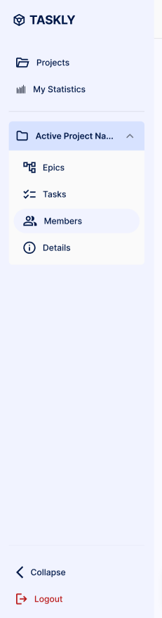
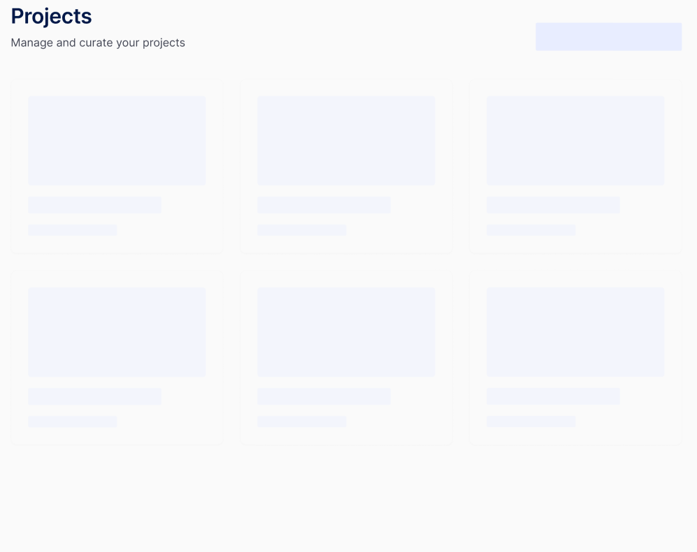
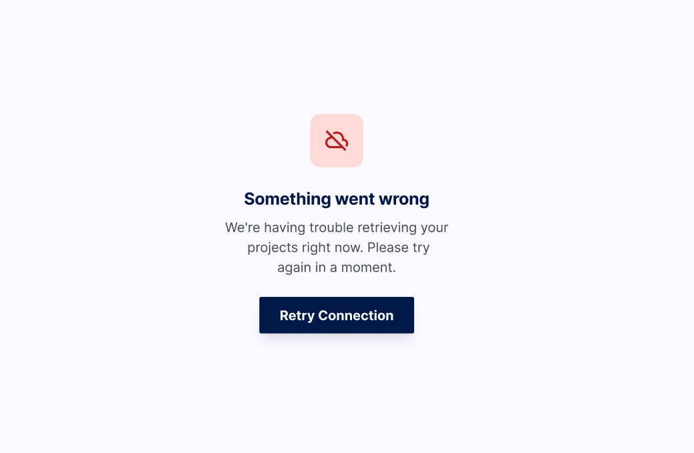
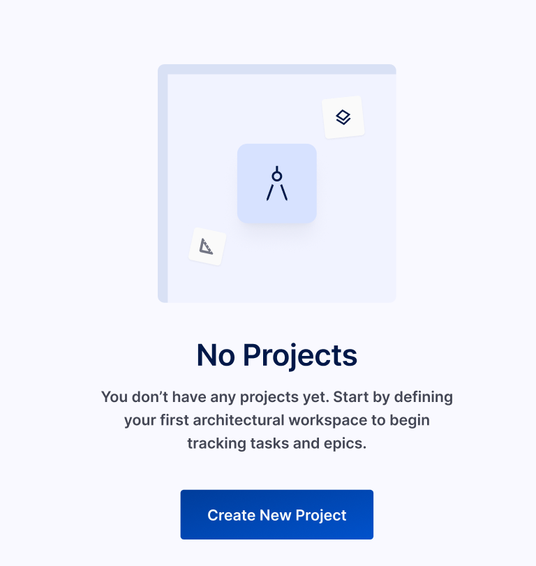
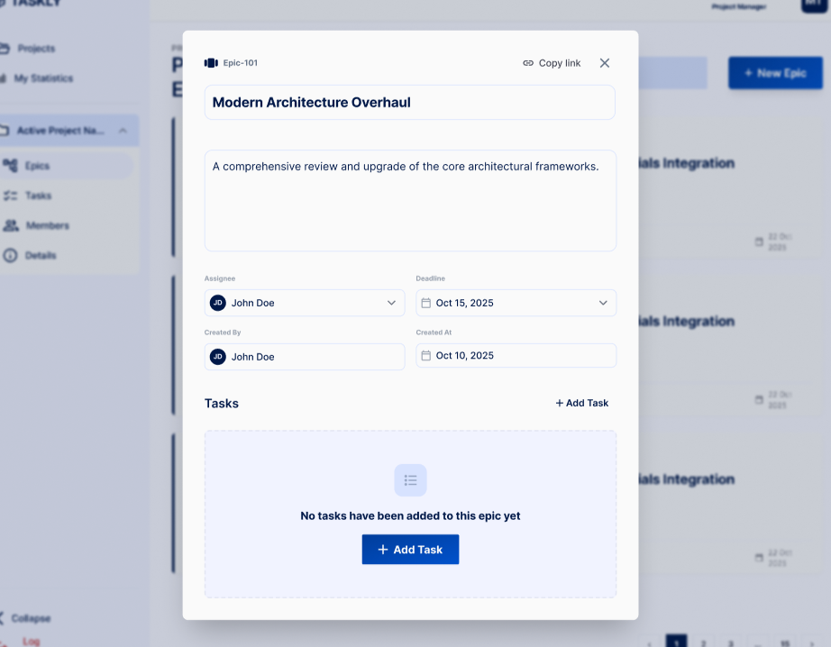
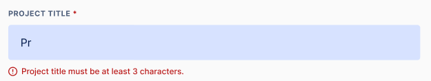
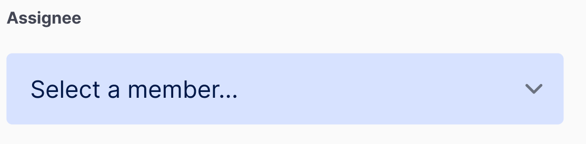

<h1>Taskly</h1>

A list of the reusable UI components used across Taskly's screens, documented before implementation to keep the design consistent and avoid duplicated code.

| # | Component | Description | Used In | Screenshot |
|---|-----------|-------------|---------|------------|
| 1 | Header | Top navigation bar | All authenticated pages |  |
| 2 | Sidebar | Main application navigation | All authenticated pages |  |
| 3 | Button  | Primary/secondary application actions | Forms, Modals, Headers, Cards.. |  |
| 4 | Loading Skeleton | Animated loading skeleton while data is fetching | Projects, Members, Epics |  |
| 5 | Error state | Standardized error container with error message and retry action | Projects, Members, Epics |  |
| 6 | Empty state | Placeholder block with illustration/icon, description, and optional button | Epics List, Task Board, Projects List |  |
| 7 | Modal/Popup | Popup overlay on screen | Add/Edit Projects/Epics …  |  |
| 8 | Avatar | Initials icon | User/members |  |
| 9 | Input fields | Standardized form input with label, placeholder, icon, and hint | Login, Register, Add/Edit Project, Add/Edit Epic, Add/Edit Task, Invite Member  |  |
| 10 | Dropdown | Dropdown menu selection | Add/Edit Task, Add/Edit Epics |  |
